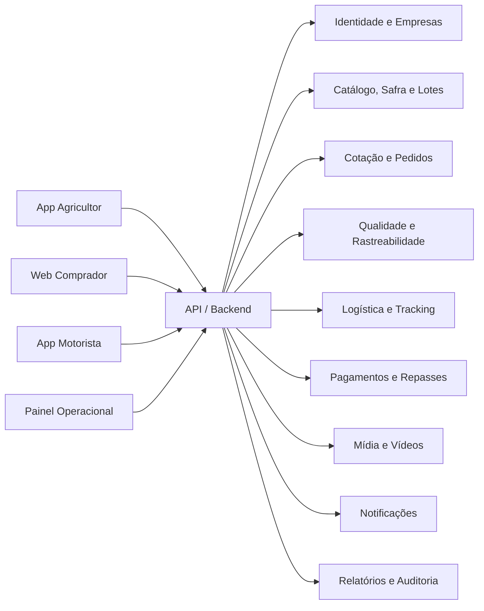

# PRD — Plataforma AgroDireto
## Comercialização direta do campo ao comprador, com qualidade, rastreabilidade e logística integrada

**Versão:** 1.0  
**Data:** 04/11/2026  
**Status:** Documento-base para discovery, estimativa e desenho de MVP  
**Plataformas:** Web desktop responsiva, aplicativo mobile para Android/iOS, painel operacional web

---

## 1. Resumo executivo

A AgroDireto será um ecossistema digital que conecta agricultores a compradores profissionais de produtos agrícolas — aqui chamados de **compradores** ou **fornecedores da cadeia**, como distribuidores, atacadistas, indústrias, supermercados, restaurantes, hotéis e cozinhas institucionais.

A plataforma cuidará do ciclo completo:

1. cadastro e validação do agricultor;
2. apresentação da propriedade, produção, práticas e capacidade;
3. planejamento e previsão de safra;
4. publicação de lotes disponíveis ou futuros;
5. descoberta, cotação, negociação e compra;
6. controle de qualidade, documentos e certificações;
7. contratação e acompanhamento do transporte;
8. rastreabilidade do lote desde a origem até a entrega;
9. pagamentos, repasses, conciliação e resolução de ocorrências;
10. relacionamento recorrente e indicadores para todos os participantes.

O diferencial central será combinar **marketplace B2B**, **gestão agro**, **evidências visuais da propriedade — incluindo vídeos de drone —**, **controle de lotes** e **logística rastreável** em uma única experiência.

> O vídeo de drone será tratado como evidência e conteúdo comercial, não como prova automática de qualidade ou produtividade. A plataforma deverá exibir data, local aproximado, responsável pelo upload e status de validação.

---

## 2. Problema e oportunidade

### 2.1 Problemas do agricultor

- Dependência de intermediários e baixa previsibilidade de demanda.
- Dificuldade para demonstrar origem, escala, práticas e capacidade de entrega.
- Negociação dispersa em telefone, WhatsApp e planilhas.
- Pouca visibilidade sobre preços, custos logísticos e prazo de recebimento.
- Perdas por falta de comprador, atraso ou falha no planejamento de colheita.
- Dificuldade para organizar documentos, certificações e evidências de produção.

### 2.2 Problemas do comprador

- Dificuldade de encontrar produtores confiáveis em determinada região e janela de entrega.
- Informações incompletas sobre volume, calibre, padrão, qualidade e disponibilidade.
- Falta de rastreabilidade e evidências de origem.
- Contratação de transporte fragmentada.
- Falta de visibilidade durante coleta, trânsito e entrega.
- Risco de divergência entre o comprado, o expedido e o recebido.

### 2.3 Oportunidade

Criar uma infraestrutura confiável para o comércio agrícola profissional, começando por determinadas culturas e regiões-piloto, com expansão posterior para mais categorias, serviços financeiros, seguros, insumos e inteligência de mercado.

---

## 3. Visão, missão e princípios

### Visão

Ser a camada operacional e comercial que conecta produção agrícola confiável à demanda profissional, reduzindo desperdício e aumentando a previsibilidade da cadeia.

### Missão

Permitir que agricultores vendam melhor e que compradores comprem com mais confiança, rastreabilidade e eficiência logística.

### Princípios de produto

1. **Origem antes da aparência:** toda oferta deve indicar produtor, propriedade, lote e região.
2. **Confiança verificável:** perfis, documentos, fotos, vídeos e certificações devem ter status de validação.
3. **Mobile first para o campo:** ações essenciais devem funcionar com baixa conectividade.
4. **Transparência comercial:** preço, taxas, condições, descontos, frete e prazo devem estar claros.
5. **Operação assistida:** o sistema automatiza, mas a equipe operacional pode intervir e registrar justificativas.
6. **Não prometer o que não foi medido:** previsões de safra, qualidade e prazo devem possuir nível de confiança e fonte.
7. **Escalar por módulos:** começar com marketplace, lotes e logística; adicionar crédito, seguro e insumos depois.

---

## 4. Escopo e não escopo

### 4.1 Escopo do produto

- Cadastro e onboarding de agricultores, compradores, transportadores e operadores.
- Perfil da propriedade e ficha produtiva.
- Produtos, variedades, calendários, previsão e disponibilidade.
- Cadastro e gerenciamento de lotes.
- Catálogo e busca B2B.
- Pedido de cotação, propostas, negociação e pedidos.
- Controle de documentos, certificados e conformidade.
- Agendamento de coleta, despacho, tracking e confirmação de entrega.
- Evidências de origem, qualidade, coleta e recebimento.
- Vídeos e fotos de campo, incluindo drone.
- Pagamentos, repasses, faturas e conciliação, inicialmente via parceiro de pagamentos.
- Notificações, mensagens contextuais e central de ocorrências.
- Painéis e relatórios operacionais e comerciais.

### 4.2 Fora do MVP

- Compra e venda de terras.
- Diagnóstico agronômico automatizado com promessa de precisão clínica.
- Operação própria de frota sem parceiros.
- Crédito, seguro e antecipação de recebíveis próprios.
- Leilão aberto em tempo real para todas as culturas.
- Integração profunda com maquinário agrícola de múltiplas marcas.
- Certificação oficial emitida pela plataforma.
- Pagamentos em espécie ou fora do fluxo registrado.

---

## 5. Usuários e perfis de acesso

### 5.1 Agricultor / produtor

Pessoa física, empresa rural, cooperativa ou representante autorizado. Publica produção, lotes, documentos e aceita ou negocia pedidos.

### 5.2 Comprador profissional

Distribuidor, atacadista, indústria, varejista, restaurante, hotel, escola, hospital ou outro comprador recorrente. Pesquisa, solicita cotação, compra e acompanha entrega.

### 5.3 Transportador / motorista

Transportadora contratada ou motorista vinculado a uma operação. Visualiza cargas atribuídas, rota, coleta, evidências e ocorrências.

### 5.4 Inspetor / agente de qualidade

Profissional interno ou parceiro que verifica lote, amostras, documentação, embalagem, classificação e divergências.

### 5.5 Operador da AgroDireto

Equipe de suporte, comercial, logística, qualidade e financeiro. Pode revisar cadastros, intermediar conflitos, criar pedidos assistidos e corrigir dados com trilha de auditoria.

### 5.6 Administrador

Gerencia usuários, permissões, regiões, culturas, tabelas de qualidade, taxas, integrações e configurações.

### 5.7 Parceiro institucional — fase posterior

Cooperativa, órgão técnico, certificadora, laboratório, seguradora ou instituição financeira com acesso restrito e consentido.

---

## 6. Proposta de valor por público

| Público | Valor principal |
|---|---|
| Agricultor | Mais compradores, melhor previsibilidade, reputação digital, negociação direta e menor desperdício |
| Comprador | Oferta confiável, origem documentada, negociação estruturada e entrega rastreável |
| Transportador | Mais cargas, agenda organizada, instruções claras e comprovação de entrega |
| Operador | Visibilidade ponta a ponta, menos planilhas e capacidade de intervir antes da falha |
| AgroDireto | Receita por transação, serviços logísticos e dados agregados da cadeia |

---

## 7. Jornadas principais

### Jornada A — Agricultor entra e publica a produção

1. Instala o app ou acessa o web app.
2. Cria conta com telefone/e-mail.
3. Informa identidade, propriedade, localização e dados de pagamento.
4. Cadastra culturas, variedades, área, capacidade, calendário e práticas.
5. Envia fotos, vídeos, documentos e certificações.
6. Recebe status de validação e pendências.
7. Cria previsão de safra ou lote disponível.
8. Define quantidade, unidade, padrão, preço orientativo, janela de colheita e local.
9. Publica para compradores elegíveis.
10. Recebe interesse, cotação ou pedido.
11. Aceita, contrapropõe ou recusa.
12. Prepara o lote, confirma colheita e entrega ao transportador.
13. Acompanha status e recebe pagamento após as regras do pedido.

### Jornada B — Comprador encontra e compra

1. Cria conta empresarial e informa demanda.
2. Pesquisa por produto, região, volume, janela, certificação e distância.
3. Acessa a ficha do produtor e a página do lote.
4. Solicita cotação ou compra conforme preço disponível.
5. Negocia quantidade, preço, qualidade, embalagem, frete e prazo.
6. Confirma pedido e condição de pagamento.
7. Acompanha preparação, coleta e transporte.
8. Recebe, confere e envia evidências.
9. Aceita, abre ocorrência ou solicita ajuste.
10. Avalia o produtor, transporte e experiência.

### Jornada C — Operação logística

1. Pedido confirmado cria uma ordem logística.
2. Operador define tipo de veículo, temperatura, janela e restrições.
3. Transportador aceita a carga.
4. Agricultor confirma lote pronto.
5. Motorista registra chegada, coleta, peso/quantidade e evidências.
6. Sistema atualiza ETA e envia eventos.
7. Comprador acompanha em mapa e linha do tempo.
8. Comprador confirma recebimento e divergências.
9. Sistema calcula repasse, frete, taxa e pendências.

### Jornada D — Qualidade e rastreabilidade

1. Cada oferta gera ou referencia um lote único.
2. O lote recebe origem, propriedade, cultura, variedade, data, quantidade e padrão.
3. Evidências são vinculadas ao lote, não apenas ao perfil.
4. Inspeção registra critérios e resultado.
5. Eventos de transformação, consolidação ou divisão geram novos vínculos.
6. A entrega mantém histórico de custódia.
7. Em caso de problema, o lote pode ser bloqueado e os compradores afetados identificados.

---

## 8. Requisitos funcionais por módulo

### 8.1 Identidade, acesso e onboarding

- Cadastro por telefone, e-mail ou convite empresarial.
- Login com senha, código temporário e, futuramente, biometria/passkey.
- Recuperação de acesso.
- Termos de uso, política de privacidade e consentimentos específicos.
- Perfis com múltiplos usuários e permissões por empresa.
- Verificação de identidade e dados da empresa conforme risco e etapa.
- Status: rascunho, pendente, em análise, aprovado, rejeitado, suspenso.
- Lista clara de pendências e possibilidade de salvar e continuar depois.
- Modo assistido pelo operador, com consentimento e trilha de auditoria.

### 8.2 Ficha do agricultor e da propriedade

A ficha deve ser um ativo comercial, não apenas um cadastro.

**Dados mínimos:** nome/razão social, foto ou logo, contato, localização aproximada, município/estado, tipo de produtor, área produtiva, culturas, variedades, capacidade estimada, época de colheita, infraestrutura, embalagem, práticas agrícolas, certificações, documentos, avaliações, histórico de entregas e mídias.

**Privacidade:** endereço exato, telefone pessoal e coordenadas precisas não devem ser públicos por padrão. O comprador vê a região e recebe dados operacionais somente após uma etapa autorizada do pedido.

### 8.3 Catálogo de produtos e culturas

- Produto, categoria, variedade, unidade de comercialização e atributos.
- Padrões de classificação por produto.
- Fotos de referência e especificação técnica.
- Safra, sazonalidade e janela de disponibilidade.
- Filtros por região, quantidade, qualidade, certificação, preço, distância e prazo.
- Produtos recorrentes e favoritos.

### 8.4 Planejamento de safra e previsão

- Calendário por cultura e talhão opcional.
- Etapas: plantio, desenvolvimento, previsão inicial, pré-colheita, pronto para colheita e encerrado.
- Estimativa de volume e intervalo de confiança.
- Atualização manual pelo agricultor.
- Histórico de revisões com data e autor.
- Alertas para discrepância entre previsão e lote publicado.
- Possibilidade de vender antecipadamente mediante regras de risco e aprovação.

### 8.5 Lotes e ofertas

Todo lote deverá possuir identificador único e QR Code.

**Campos:** produto, variedade, produtor, propriedade, origem, safra, quantidade estimada/disponível, unidade, padrão, calibre/tamanho, qualidade, data de colheita, janela de retirada, embalagem, temperatura recomendada, preço, condição de pagamento, validade da oferta, fotos/vídeos, documentos, status e visibilidade.

**Estados do lote:** rascunho, aguardando revisão, publicado, reservado, parcialmente vendido, confirmado, em preparação, coletado, em trânsito, entregue, bloqueado, encerrado, cancelado.

### 8.6 Vídeos de drone, fotos e evidências

- Upload de fotos, vídeos curtos e vídeos de drone.
- Compressão e processamento assíncrono.
- Armazenamento do arquivo original e versão otimizada.
- Metadados: data, local, operador, duração, dispositivo, lote/propriedade associada.
- Visibilidade: privado, compradores aprovados, público dentro da plataforma.
- Moderação de conteúdo e status de validação.
- Legenda, título, cultura, etapa da safra e observações.
- Marca d’água e proteção contra download quando necessário.
- Registro de que o conteúdo é evidência visual, não certificação de produtividade.
- Controle de consentimento e de pessoas identificáveis nas imagens.

### 8.7 Cotação, negociação e pedido

- Cotação iniciada pelo comprador ou agricultor.
- Proposta com quantidade, preço, padrão, embalagem, frete, data, condição de pagamento e validade.
- Contraproposta com histórico imutável.
- Aprovação por alçada para empresas compradoras.
- Conversa vinculada ao produto/lote/pedido, evitando negociação sem contexto.
- Conversão de proposta aceita em pedido.
- Pedido parcial e divisão por lotes.
- Cancelamento com motivo e regras de penalidade.
- Geração de resumo comercial e aceite eletrônico.

### 8.8 Compra e venda / checkout B2B

- Carrinho ou pedido direto, conforme modelo comercial.
- Revisão de itens, quantidade, preço, taxa, frete, impostos e total.
- Endereço de entrega e janela de recebimento.
- Condição: pagamento antecipado, na entrega, prazo ou faturamento aprovado.
- Limite de crédito interno ou parceiro, quando aplicável.
- Nota de que impostos e documentos fiscais dependem da configuração do país/estado e integração contábil.
- Confirmação com número de pedido e próximos passos.

### 8.9 Qualidade, inspeção e conformidade

- Checklist por cultura ou categoria.
- Registro de inspeção na origem, na coleta e no recebimento.
- Campos de quantidade, peso, embalagem, aparência, maturação, avarias e temperatura.
- Upload de laudos e certificados.
- Aprovação, aprovação condicionada, reprovação e quarentena.
- Amostragem e divergência entre declarado e conferido.
- Bloqueio de lote e alerta aos envolvidos.
- Validade e vencimento de documentos.

### 8.10 Logística e rastreamento

- Ordem logística criada pelo pedido.
- Cotação e seleção de transportador.
- Definição de veículo, capacidade, refrigeração, seguro e requisitos.
- Agendamento de coleta e entrega.
- Check-in/out por geolocalização com consentimento.
- Status: aguardando agendamento, agendado, veículo a caminho, no local, coletado, em trânsito, atraso, entregue, ocorrência.
- ETA e atualização por eventos do motorista, GPS ou operador.
- Prova de coleta e prova de entrega: foto, assinatura, nome, horário, localização e observação.
- Ocorrências: ausência, avaria, temperatura, atraso, quantidade divergente, acesso bloqueado, acidente e cancelamento.
- Compartilhamento de rastreio por link seguro e temporário.

### 8.11 Pagamentos e financeiro

- Carteira de transações por empresa.
- Status: aguardando, autorizado, pago, em repasse, repassado, estornado, em disputa.
- Cálculo de comissão, frete, descontos e repasses.
- Conta bancária ou chave de recebimento validada.
- Extrato, fatura, recibo e comprovante.
- Conciliação com gateway/PSP.
- Regras de retenção até recebimento, inspeção ou período de disputa.
- Não armazenar dados de cartão diretamente no produto; usar parceiro certificado.

### 8.12 Mensagens, notificações e suporte

- Caixa de entrada por pedido.
- Notificações push, e-mail, SMS ou WhatsApp conforme configuração.
- Alertas de pendência, proposta, aprovação, coleta, atraso, ocorrência e pagamento.
- Templates editáveis pelo administrador.
- Central de ajuda, FAQ e abertura de chamado.
- Botão de emergência logística para ocorrências críticas.

### 8.13 Avaliações e reputação

- Avaliação separada de produto, conformidade, comunicação e logística.
- Nota só após transação concluída.
- Direito de resposta.
- Reputação ponderada por volume, recência e disputas, evitando que uma ocorrência isolada defina o perfil.
- Indicadores: taxa de aceite, cumprimento de prazo, divergência, cancelamento e resposta.

### 8.14 Administração e operação

- Dashboard geral.
- Fila de validação de cadastros.
- Fila de mídia e documentos.
- Monitoramento de pedidos e cargas.
- Gestão de ocorrências e disputas.
- Gestão de taxas, categorias, padrões e regiões.
- Usuários, empresas, permissões e logs.
- Reprocessamento de integrações.
- Exportação de relatórios.

---

## 9. Inventário completo de telas

### 9.1 Telas comuns — web e mobile

1. Splash/carregamento.
2. Boas-vindas e proposta de valor.
3. Escolha do tipo de conta.
4. Login.
5. Criar conta.
6. Verificação de telefone/e-mail.
7. Recuperar acesso.
8. Termos e consentimentos.
9. Seleção de região e idioma.
10. Central de notificações.
11. Busca global.
12. Ajuda e suporte.
13. Perfil do usuário.
14. Trocar empresa/conta.
15. Configurações e preferências.
16. Privacidade e permissões.
17. Segurança e sessões ativas.
18. Status do sistema/manutenção.
19. Tela de erro e tentativa novamente.
20. Estado offline e sincronização pendente.

### 9.2 Agricultor — onboarding e perfil

21. Progresso do onboarding.
22. Dados pessoais ou da empresa rural.
23. Documento de identificação/empresa.
24. Dados bancários e recebimento.
25. Cadastro da propriedade.
26. Localização da propriedade com precisão controlada.
27. Áreas, talhões e infraestrutura.
28. Cadastro de culturas.
29. Cadastro de variedades.
30. Calendário agrícola.
31. Práticas agrícolas e sustentabilidade.
32. Certificações e licenças.
33. Upload de documentos.
34. Upload de fotos da propriedade.
35. Upload de vídeo de drone.
36. Pré-visualização do perfil público.
37. Pendências de validação.
38. Perfil publicado.
39. Editar perfil.
40. Avaliações e reputação.

### 9.3 Agricultor — produção e vendas

41. Dashboard do agricultor.
42. Minha produção.
43. Calendário de safra.
44. Nova previsão de safra.
45. Detalhe da previsão.
46. Nova oferta/lote.
47. Assistente de criação de lote.
48. Classificação e padrão do lote.
49. Fotos e vídeos do lote.
50. Definição de preço e condições.
51. Pré-visualização da oferta.
52. Meus lotes.
53. Detalhe do lote.
54. QR Code do lote.
55. Editar lote.
56. Reservas e pedidos ligados ao lote.
57. Cotações recebidas.
58. Detalhe da cotação.
59. Contraproposta.
60. Negociação em andamento.
61. Pedidos recebidos.
62. Detalhe do pedido.
63. Preparação da colheita.
64. Confirmar lote pronto.
65. Agendamento de coleta.
66. Inspeção na origem.
67. Entrega ao transportador.
68. Acompanhar transporte.
69. Ocorrência do pedido.
70. Financeiro e repasses.
71. Extrato.
72. Detalhe de transação.
73. Solicitar suporte.

### 9.4 Comprador — descoberta e compra

74. Dashboard do comprador.
75. Catálogo de produtos.
76. Resultado de busca.
77. Filtros avançados.
78. Mapa de produtores e ofertas.
79. Perfil do agricultor.
80. Galeria de mídia da propriedade.
81. Detalhe da oferta/lote.
82. Comparar ofertas.
83. Solicitar cotação.
84. Cotação enviada.
85. Minhas cotações.
86. Detalhe da cotação.
87. Negociação.
88. Favoritos e fornecedores acompanhados.
89. Carrinho ou resumo de compra.
90. Checkout B2B.
91. Endereço e janela de recebimento.
92. Condição de pagamento.
93. Revisão e aceite.
94. Pedido confirmado.
95. Meus pedidos.
96. Detalhe do pedido.
97. Rastreamento da carga.
98. Conferência do recebimento.
99. Registrar divergência.
100. Avaliar transação.
101. Faturas e financeiro.

### 9.5 Transportador / motorista

102. Dashboard do transportador.
103. Cadastro da transportadora.
104. Veículos.
105. Motoristas.
106. Documentos e seguros.
107. Ofertas de carga.
108. Detalhe da carga.
109. Aceitar ou recusar carga.
110. Agenda de coletas.
111. Navegação/rota.
112. Check-in no produtor.
113. Conferência da coleta.
114. Registrar peso e evidências.
115. Iniciar transporte.
116. Status da viagem.
117. Registrar ocorrência.
118. Check-in no comprador.
119. Prova de entrega.
120. Histórico de viagens.
121. Repasses do transportador.

### 9.6 Qualidade e operação interna

122. Dashboard operacional.
123. Fila de novos cadastros.
124. Análise de agricultor.
125. Análise de comprador.
126. Fila de documentos.
127. Fila de mídias.
128. Fila de lotes para revisão.
129. Agenda de inspeções.
130. Formulário de inspeção.
131. Mapa de pedidos ativos.
132. Torre de controle logística.
133. Detalhe de pedido operacional.
134. Detalhe de carga.
135. Ocorrências abertas.
136. Disputa comercial.
137. Quarentena/bloqueio de lote.
138. Busca global operacional.
139. Chat de suporte.
140. Reembolso/ajuste financeiro.
141. Reconciliação de pagamentos.
142. Relatórios operacionais.
143. Auditoria e logs.

### 9.7 Administração

144. Dashboard administrativo.
145. Usuários.
146. Empresas.
147. Papéis e permissões.
148. Regiões e áreas de operação.
149. Produtos e categorias.
150. Variedades.
151. Padrões de qualidade.
152. Unidades e embalagens.
153. Taxas e comissões.
154. Regras de pagamento.
155. Regras de logística.
156. Templates de notificação.
157. Configurações de integração.
158. Webhooks e eventos.
159. Feature flags.
160. Logs e auditoria.
161. Gestão de conteúdo e banners.
162. Exportações.

---

## 10. Especificação das telas mais críticas

### 10.1 Dashboard do agricultor

**Objetivo:** permitir que o agricultor saiba o que exige ação hoje.

**Componentes:** resumo da receita, lotes disponíveis, pedidos em andamento, próximas coletas, pendências de cadastro, previsão de recebimentos, alertas de atraso, atalho “publicar lote”, calendário de safra e recomendações acionáveis.

**Estados:** primeiro acesso sem dados; cadastro incompleto; produção cadastrada; operação ativa; sem conectividade; erro de sincronização.

### 10.2 Perfil público do agricultor

**Componentes:** foto/nome, localização regional, culturas, capacidade, época de colheita, práticas, certificações verificadas, histórico de entregas, avaliação, galeria, vídeos, lotes atuais e botão “solicitar cotação”.

**Regra:** diferenciar claramente informações declaradas, verificadas e expiradas.

### 10.3 Detalhe do lote

**Componentes:** produto, variedade, fotos, vídeo, quantidade, unidade, padrão, colheita, validade, local de retirada, preço ou “solicitar cotação”, disponibilidade, certificações, QR Code, histórico de inspeção e ação de compra.

### 10.4 Checkout e pedido B2B

**Componentes:** itens, preço, impostos/taxas quando aplicáveis, frete, janela, endereço, condição de pagamento, responsável pela aprovação, política de cancelamento, resumo final e aceite.

**Regra:** nenhuma taxa ou alteração negociada pode aparecer apenas depois da confirmação.

### 10.5 Torre de controle logística

**Componentes:** mapa, filtros por status/região/atraso, lista de cargas, ETA, temperatura quando houver, última atualização, ocorrências, contato contextual e ações de escalonamento.

### 10.6 Timeline do pedido

Eventos: pedido criado, proposta aceita, pagamento autorizado, lote confirmado, coleta agendada, veículo a caminho, coletado, em trânsito, chegada prevista, entregue, inspeção concluída, pagamento liberado.

Cada evento mostra data/hora, origem, responsável e evidência quando disponível.

### 10.7 Registro de ocorrência

Campos obrigatórios: tipo, severidade, pedido/lote/carga, descrição, fotos/vídeos, localização opcional, impacto, ação imediata e responsável. Deve gerar protocolo e prazo esperado de resposta.

---

## 11. Requisitos não funcionais

### Segurança e privacidade

- Criptografia em trânsito e em repouso.
- Controle de acesso por função, empresa e objeto.
- MFA para operadores e administradores.
- Logs de alteração, acesso e exportação.
- Minimização de dados pessoais e anonimização em relatórios.
- Consentimento para localização, mídia e compartilhamento.
- Adequação à LGPD, com apoio jurídico antes da operação comercial.
- Plano de retenção e exclusão de dados.

### Disponibilidade e conectividade

- App tolerante a conexão instável.
- Salvamento local de formulários críticos.
- Fila de upload e sincronização.
- Indicador de último sincronismo.
- Compressão de mídia no dispositivo.
- Operações essenciais possíveis em 2G/3G, quando tecnicamente viável.

### Performance

- Primeiro conteúdo útil em até 3 segundos em conexão adequada.
- Busca paginada e com filtros no servidor.
- Upload de vídeos assíncrono.
- Processamento de thumbnails e transcodificação em fila.
- APIs idempotentes para eventos logísticos e pagamentos.

### Escalabilidade

- Arquitetura modular por domínio.
- Separação entre marketplace, pedidos, logística, pagamentos e mídia.
- Filas para notificações, mídia e integrações.
- Observabilidade com logs, métricas, traces e alertas.

### Acessibilidade

- Contraste adequado, textos redimensionáveis e navegação por teclado na web.
- Labels para leitores de tela.
- Linguagem simples e unidades claras.
- Ícones sempre acompanhados de texto em ações críticas.

---

## 12. Modelo de dados conceitual

Entidades principais:

- Usuário
- Empresa
- Perfil de agricultor
- Perfil de comprador
- Transportadora
- Propriedade
- Área/talhão
- Cultura
- Variedade
- Calendário de safra
- Previsão de produção
- Lote
- Oferta
- Mídia/evidência
- Documento/certificação
- Cotação
- Proposta
- Pedido
- Item do pedido
- Ordem logística
- Veículo
- Motorista
- Evento de rastreamento
- Inspeção
- Ocorrência
- Pagamento
- Repasse
- Avaliação
- Notificação
- Chamado
- Log de auditoria

**Relações críticas:** um pedido pode conter vários lotes; um lote pode ser vendido parcialmente; uma carga pode consolidar itens de vários pedidos se a operação permitir; todo evento deve apontar para o objeto afetado e para o autor.

---

## 13. Integrações recomendadas

### MVP

- Provedor de autenticação e envio de SMS/e-mail.
- Gateway/PSP de pagamento.
- Armazenamento de objetos e CDN para fotos/vídeos.
- Mapas, geocodificação e rotas.
- Serviço de push notifications.
- Serviço de monitoramento e analytics.

### Fase 2

- ERP/financeiro do comprador.
- Emissão fiscal conforme jurisdição e modelo operacional.
- TMS/WMS de parceiros.
- Rastreamento via API de transportadoras.
- Laboratórios e certificadoras.
- WhatsApp Business API.
- Imagens de satélite e clima, com cuidado para não prometer diagnóstico.

---

## 14. Arquitetura funcional sugerida

O MVP pode ser um monólito modular bem delimitado, desde que os domínios tenham contratos claros e filas para tarefas assíncronas. Microserviços só devem ser introduzidos quando houver necessidade operacional comprovada.

---

## 15. MVP recomendado

### Objetivo do MVP

Validar se agricultores conseguem publicar oferta real e se compradores profissionais conseguem fechar e receber pedidos com rastreabilidade suficiente em uma região e conjunto de culturas limitado.

### Incluído

- Cadastro de agricultor e comprador.
- Ficha de propriedade e produtos.
- Upload de fotos e vídeos curtos, incluindo drone.
- Publicação de lote.
- Busca e filtros básicos.
- Cotação, contraproposta e aceite.
- Pedido e checkout com um método de pagamento.
- Ordem logística e tracking por eventos manuais/app motorista.
- Prova de coleta e entrega.
- Ocorrências.
- Avaliações.
- Painel operacional básico.
- Extrato e status de repasse.

### Postergado

- Previsão avançada por talhão.
- Leilão.
- Crédito, seguro e antecipação.
- IA para análise visual.
- Integrações extensas com ERP/TMS.
- API pública para terceiros.
- Programa de fidelidade.

### Critério de sucesso do MVP

Em uma região-piloto, alcançar transações reais recorrentes, com baixa taxa de cancelamento, rastreamento de pedidos e capacidade da equipe de resolver divergências dentro do SLA definido.

---

## 16. Roadmap sugerido

### Fase 0 — Discovery e operação assistida, 4–6 semanas

- Escolha de região e 2–4 culturas.
- Entrevistas com agricultores, compradores e transportadores.
- Definição de padrões de qualidade e embalagem.
- Cadastro manual de primeiros participantes.
- Mapeamento jurídico, fiscal e de privacidade.
- Protótipos e teste de usabilidade.

### Fase 1 — MVP transacional, 12–16 semanas

- Apps/web essenciais.
- Catálogo, lotes, cotações, pedidos, logística e pagamentos.
- Operação centralizada de suporte e qualidade.

### Fase 2 — Escala e confiabilidade, 8–12 semanas

- Melhorias de offline.
- Regras de reputação.
- Integrações com transportadoras.
- Relatórios e previsão de demanda.
- Melhoria de vídeo e evidências.

### Fase 3 — Ecossistema, 12+ semanas

- Serviços financeiros via parceiros.
- Seguros.
- Compra de insumos.
- Laboratórios, certificações e cooperativas.
- APIs e integrações corporativas.
- Dados agregados de mercado.

---

## 17. Métricas e KPIs

### Funil de oferta

- Agricultores cadastrados.
- Agricultores aprovados.
- Agricultores com pelo menos um lote publicado.
- Lotes publicados por semana.
- Percentual de lotes com mídia e documentação completas.

### Liquidez do marketplace

- Compradores ativos.
- Tempo até primeiro interesse.
- Tempo até proposta.
- Taxa de conversão de oferta em pedido.
- GMV e valor médio do pedido.
- Taxa de recompra.

### Operação e qualidade

- Entregas no prazo.
- Divergência de quantidade.
- Taxa de rejeição.
- Cancelamentos por motivo.
- Ocorrências por 100 pedidos.
- Tempo médio de resolução.
- Percentual de pedidos com rastreabilidade completa.

### Financeiro

- Receita de comissão.
- Margem logística.
- Custo de suporte por pedido.
- Tempo até repasse ao agricultor.
- Taxa de falha de pagamento.
- Valor em disputa.

### Confiança

- Nota média de compradores e agricultores.
- Taxa de documentos vencidos.
- Denúncias de conteúdo ou fraude.
- Incidentes de privacidade e segurança.

---

## 18. Regras de negócio essenciais

1. Nenhum lote pode ser publicado sem produtor, produto, unidade, quantidade e janela de disponibilidade.
2. Lote vencido não aparece como disponível, mas permanece no histórico.
3. Quantidade reservada não pode ser vendida novamente.
4. Alteração de preço ou quantidade após proposta deve gerar nova versão.
5. Toda negociação aceita deve gerar um resumo imutável.
6. Dados bancários só ficam disponíveis para funções autorizadas.
7. Mídia não validada deve ser identificada como “não verificada”.
8. A avaliação só pode ocorrer após entrega ou cancelamento elegível.
9. Ocorrência financeira não pode ser encerrada sem motivo e evidência.
10. Eventos de rastreamento devem ser idempotentes e ter data/hora do dispositivo e do servidor quando possível.
11. Operador pode corrigir dados, mas sempre deve informar motivo e preservar o valor anterior.
12. Pedido com lote bloqueado deve entrar em fluxo de decisão operacional.

---

## 19. Riscos e mitigação

| Risco | Mitigação |
|---|---|
| Baixa adesão digital do agricultor | Onboarding assistido, app simples, suporte regional e funcionamento offline |
| Oferta sem padrão comparável | Catálogo por cultura, unidades padronizadas e checklists de qualidade |
| Compradores não confiarem na oferta | Verificação, evidências, histórico, inspeção e reputação |
| Disputa de qualidade | Critérios definidos antes da compra, amostragem e prova na origem/recebimento |
| Vídeo de drone expor localização sensível | Região aproximada, controle de visibilidade e remoção de metadados sensíveis |
| Atrasos logísticos | ETA, transportadores avaliados, alertas e plano de contingência |
| Complexidade fiscal/regulatória | Descoberta jurídica por região e integração com especialistas antes da escala |
| Fraude ou identidade falsa | KYC/KYB progressivo, validação documental e análise de comportamento |
| Dependência de conectividade | Offline-first para tarefas de campo e sincronização posterior |
| Custo alto de mídia | Limites de duração/tamanho, transcodificação, CDN e retenção configurável |

---

## 20. Critérios de aceite do MVP

### Cadastro do agricultor

- O usuário consegue iniciar, interromper e retomar o cadastro.
- O sistema mostra pendências e status de análise.
- O perfil pode ser publicado somente com campos obrigatórios completos.

### Publicação do lote

- O agricultor consegue criar um lote em menos de alguns minutos após o cadastro inicial.
- O lote tem identificador único, status, disponibilidade e mídia opcional.
- A quantidade disponível é atualizada quando há reserva, venda ou ajuste aprovado.

### Compra

- O comprador encontra ofertas usando ao menos produto, região, janela e quantidade.
- A cotação preserva histórico de propostas.
- Um aceite gera pedido com resumo de preço, frete, condição e entrega.

### Logística

- Cada pedido confirmado possui ordem logística.
- O motorista ou operador consegue registrar coleta, trânsito, ocorrência e entrega.
- O comprador visualiza uma timeline atualizada.

### Financeiro

- O sistema mostra claramente o valor total e o status do pagamento.
- O agricultor consegue consultar o repasse e o motivo de eventual retenção.

### Operação

- O operador consegue localizar um pedido por produtor, comprador, lote ou carga.
- Consegue bloquear lote, abrir ocorrência e registrar intervenção.
- Toda intervenção fica auditável.

---

## 21. Recomendação de experiência visual

- Linguagem visual limpa, confiável e ligada ao campo, evitando estética excessivamente ruralizada ou genérica.
- Uso de mapas, timelines e cards de lote.
- Cores de status consistentes: disponível, atenção, em trânsito, concluído, bloqueado.
- Fotos e vídeos como prova contextual, nunca como decoração sem informação.
- Botões principais orientados a ação: “Publicar lote”, “Solicitar cotação”, “Aceitar proposta”, “Confirmar coleta”, “Registrar ocorrência”.
- No mobile, navegação inferior com: Início, Produção/Ofertas, Pedidos, Mensagens e Perfil.
- No desktop, navegação lateral com filtros e painéis operacionais.

---

## 22. Decisões que precisam ser tomadas no discovery

1. Em qual país/estado a operação começa?
2. “Fornecedor” será comprador profissional, distribuidor, ou outro papel específico?
3. Quais culturas e padrões entram no piloto?
4. A AgroDireto será marketplace, intermediadora comercial ou comprará e revenderá em nome próprio?
5. Quem assume risco de qualidade, transporte, perda e inadimplência?
6. O preço será livre, tabelado, orientativo ou formado por cotação?
7. Haverá emissão fiscal dentro da plataforma?
8. O transporte será contratado pelo comprador, agricultor ou AgroDireto?
9. O pagamento será antecipado, na entrega ou a prazo?
10. Qual é a política para perecíveis, rejeição e devolução?
11. Qual nível de verificação será obrigatório antes de publicar?
12. Quais dispositivos e condições de conectividade são mais comuns entre os agricultores-piloto?
13. Quais dados podem ser mostrados publicamente e quais só após aprovação?
14. Como o vídeo de drone será coletado, validado, moderado e armazenado?
15. Quais parceiros iniciais fornecerão logística, pagamentos, qualidade e suporte?

---

## 23. Conclusão

A ideia é viável se for tratada como uma plataforma de operação da cadeia, não apenas como um catálogo de produtores. O ponto de maior valor está na combinação de **oferta qualificada + negociação estruturada + lote rastreável + logística visível + resolução operacional**.

A recomendação é começar pequeno, com uma região, poucas culturas, compradores âncora e operação assistida. Depois de comprovar liquidez, qualidade e entrega, a AgroDireto pode evoluir para um ecossistema completo com serviços financeiros, seguros, insumos, dados e integrações corporativas.

O próximo passo recomendado é converter este PRD em: mapa de processos, protótipo das telas críticas, modelo de dados, backlog priorizado e plano de piloto com agricultores, compradores e transportadores reais.
