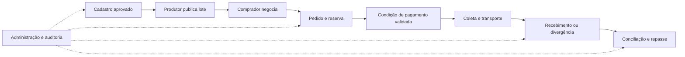

# AgroDireto — plano de desenvolvimento para piloto real

Data: 10/11/2026. Objetivo confirmado pelo usuário: **MVP funcional para um piloto com usuários reais**.
Status: diagnóstico e planejamento concluídos; implementação das próximas fases ainda não iniciada.
Backlog executável: [todo.md](todo.md). Fonte de produto: [PRD](../PRD_Plataforma_Agro_Direto.md).

## 1. Diagnóstico

O projeto é um **protótipo navegável avançado dos quatro perfis**, com um subsistema de mídia parcialmente implementado. Há interface reaproveitável; falta transformar as ações em operações persistentes, autorizadas e compartilhadas.

A “Fase 1 concluída” no histórico do Claude significa scaffold/interface. Não equivale à “Fase 1 — MVP transacional” do PRD. Não é possível medir percentual de conclusão pelo número de telas.

| Área | O que existe nesta cópia | O que falta para o piloto |
|---|---|---|
| Agricultor | 46 componentes de tela; navegação; demo autorizado; formulários; rascunho em memória; câmera/galeria no código | Auth, persistência, upload, publicação e operações reais |
| Cliente | 26 componentes de tela; navegação e estados vazios | Cadastro completo, telas com dados, busca, cotação, pedido, recebimento e pagamento |
| Logística | 26 componentes de tela; navegação e estados vazios | Cadastro operacional, atribuição de cargas, coleta, eventos e prova de entrega |
| Administrador | 26 componentes de tela; gestão visual | Acesso restrito, aprovação real, intervenção, conciliação e auditoria |
| UI compartilhada | Tokens, tipografia, cards, inputs, modais, calendário, timeline, templates | Homologação visual, acessibilidade e estados de erro/carregamento dos fluxos reais |
| Domínio compartilhado | Tipos/regras de mídia e formatos | Contratos e transições de cadastro, lote, cotação, pedido e logística |
| Backend comercial | Sem implementação localizada | Migrations, tabelas, Auth, RLS, funções de negócio e integrações |
| Worker de mídia | sharp, FFmpeg, CLI, HTTP, adaptador Supabase, Dockerfile e testes | Segurança de persistência, jobs duráveis, integração Storage/banco e validação operacional |
| Qualidade | Typecheck/lint aprovados; testes concentrados em mídia | Testes de autorização, concorrência, transação comercial, dispositivos e falhas de rede |

Contagem reproduzida pelo inventário de componentes em `apps/*/screens`: 124 telas; 132 arquivos de rota sem layouts, incluindo entrada e catálogo de telas. O histórico cita 47 telas do Agricultor; a contagem atual encontrou 46 componentes. Critérios diferentes devem ser reconciliados, sem inferir perda de uma funcionalidade.

### Evidências de comportamento

Caminhos relativos à raiz do projeto, linhas da cópia auditada:

- `apps/agricultor/hooks/dados.ts:4`: dados de demonstração.
- `apps/agricultor/screens/14-revisar-oferta/RevisarOfertaScreen.tsx:26`: “publicar” limpa o rascunho e abre um lote da demo.
- `apps/cliente/screens/14-confirmar-pedido/ConfirmarPedidoScreen.tsx:17`: “confirmar pedido” apenas navega.
- `apps/cliente/screens/03-ofertas/OfertasScreen.tsx:16`: lista vazia; é necessário implementar também a exibição de ofertas reais.
- `apps/administrador/screens/02-verificacao/VerificacaoScreen.tsx:16`: seis dígitos liberam a navegação, sem verificar identidade.
- `apps/administrador/app/(app)/_layout.tsx:4`: área privada sem guarda de sessão.
- `apps/agricultor/screens/05-fotos-videos/FotosVideosScreen.tsx:138`: envio apenas volta; seleção fica em memória.
- `packages/ui/shared/paywall/PaywallTemplate.tsx:37`: assinatura desabilitada.
- `packages/dominio/index.ts:1`: exporta somente mídia/formatos.
- `DOC/midias-compartilhadas.md:44`: schema/RLS são proposta documental, sem migrations localizadas.
- `services/midia-worker/src/supabase.ts:70`: exclusão do original precede confirmação da atualização no banco.

Não foram localizados cliente Supabase, uso efetivo de AsyncStorage ou RevenueCat nos apps. As variáveis desses serviços nos quatro arquivos `.env` estão vazias. Isso descreve **esta cópia local**, sem afirmar que não exista infraestrutura em outra conta ou máquina.

## 2. O que preservar do trabalho anterior

- Quatro apps Expo separados no monorepo, com pacotes compartilhados.
- Design system, navegação e componentes úteis já implementados.
- Supabase como backend principal; worker próprio como exceção aprovada para processamento de mídia.
- Demo do Agricultor como material de apresentação/teste, separado do ambiente de piloto.
- Limite de 100 fotos/100 vídeos e retenção de 30 dias, cujos detalhes operacionais ainda precisam ser formalizados.
- Regra de mídia pendente visível ao comprador autorizado com etiqueta “Não verificado”; mídia rejeitada não aparece.
- Onboarding/paywall conforme decisões anteriores, até eventual revisão explícita do produto.

Autorizações estão em `DOC/2026-11-05_010_quatro-apps-e-agricultor-completo.md:8`, `DOC/2026-11-05_003_lote-a-setup-design-system-agricultor.md:7` e `DOC/2026-11-05_013_limites-formatos-retencao-e-otimizacao.md:22`.

## 3. Escopo proposto para o piloto

> **Ampliado em 11/11/2026.** O recorte abaixo foi substituído pela [seção 12](#12-ampliação-do-piloto-11112026): quatro segmentos e os módulos escolhidos do Documento Mestre. A jornada mínima continua sendo a espinha do piloto.

Usar uma região e 2–4 culturas, com produtores, compradores e transportadores selecionados e operação assistida. É a direção do PRD; região, culturas, participantes e volumes ainda precisam ser escolhidos.

Jornada mínima:

Incluir: autenticação, aprovação, propriedade/cultura, lote/oferta, checklist de qualidade, fotos e vídeos curtos/drone com reprodução no Cliente, cotação, mensagens vinculadas à negociação/pedido, pedido, frete atribuído, eventos de transporte, recebimento, divergência, um fluxo de pagamento, conciliação/repasse, avaliação após entrega e suporte operacional.

Postergar, como proposta: IA de classificação, crédito/seguros, roteirização sofisticada, expansão geográfica, analytics avançado e refinamento de telas fora da jornada do piloto. Não bloquear o primeiro fluxo por todos os formatos de câmera profissional ou pelo inventário completo de telas do PRD.

Não remover recursos nem alterar regras existentes só porque foram postergados no plano. A exposição no piloto deverá refletir apenas capacidades realmente implementadas.

## 4. Decisões necessárias antes das integrações dependentes

| Decisão | Por que destrava trabalho | Momento |
|---|---|---|
| Região, culturas, unidades, padrões e participantes | Define catálogo, validações e homologação | Início |
| Papel comercial da plataforma, comissão e responsabilidade por perda | Define contrato do pedido e financeiro | Antes do pedido |
| Quem contrata/paga frete; medição de peso e tolerâncias | Define valores, coleta e recebimento | Antes de checkout/logística |
| Condição de pagamento e PSP | Define cobrança, estorno, conciliação e repasse | Seleção no início; integrar após pedido |
| Aprovação de produtor/comprador/transportador e papéis internos | Define permissões e operação assistida | Antes de Auth/RLS |
| Obrigatoriedade do paywall no piloto, inclusive equipe interna | Define acesso comercial; RevenueCat não substitui PSP | Antes de liberar usuários |
| Original versus otimizado e evidências de disputas | PRD pede ambos; worker atualmente apaga original | Antes de exclusão automática |
| Encerramento/reabertura de produção; disputa ativa; escopo da quota | Torna os 30 dias e limites executáveis | Antes de retenção |
| Canal de avisos, SLA e metas do piloto | Permite suporte e avaliação de sucesso | Definir no início e ensaiar antes da abertura |

Essas decisões não impedem preparar contratos e ambientes, mas não devem ser inventadas na implementação. Regras legais, tributárias e do provedor de pagamento precisam ser validadas no momento de fechar a operação; este diagnóstico não as resolve.

## 5. Ordem de execução e marcos de aceite

| Etapa | Entrega | Critério de conclusão | Dependência |
|---|---|---|---|
| 0 — Preparar o piloto | Escopo registrado, repositório identificado, ambientes e verificações reproduzíveis | Rodar a base em ambiente limpo e saber quais decisões bloqueiam cada integração | Nenhuma |
| 1 — Identidade e cadastros | Sessão real nos quatro apps, papéis, propriedade e aprovação | Cadastro reaparece após reiniciar; outra empresa não acessa dados privados; admin aprova com auditoria | 0 |
| 2 — Oferta real entre apps | Cultura, lote, mídia segura, revisão e listagem do comprador | Produtor publica; comprador autorizado vê exatamente o mesmo lote e mídia persistidos | 1 |
| 3 — Transação comercial | Cotação, contraproposta, aceite e pedido com reserva | Preço/condições ficam registrados; duas compras não vendem a mesma quantidade | 2 |
| 4 — Pagamento e execução | PSP, ordem logística, coleta, transporte, entrega e divergência | Pedido percorre os perfis com estado verdadeiro e evidências; pagamento não depende de ação do client | 3 |
| 5 — Fechamento da operação | Conciliação, disputa, repasse, avaliação e retenção | Valores reconciliáveis; disputa bloqueia repasse/evidências conforme regra; eventos duplicados não duplicam dinheiro; expiração de 30 dias validada | 4 |
| 6 — Homologação e piloto | Rede instável, dispositivos, avisos, monitoramento, suporte e distribuição | Jornada ensaiada, restauração testada, responsáveis e critérios de interrupção definidos | 1–5 |

As etapas não são blocos enormes de banco/API/UI. Cada tarefa do backlog deve entregar um comportamento verificável com o backend e a tela necessários. Criar tabelas e contratos à medida que o fluxo é implementado.

**Primeira entrega visível recomendada:** produtor cria conta → cadastra propriedade → administrador aprova → dados persistem e reaparecem. Depois ampliar até o lote visível no Cliente. Não iniciar pelo restante do processamento de vídeo isoladamente.

## 6. Riscos que bloqueiam dados reais

| Prioridade | Evidência e impacto | Tratamento |
|---|---|---|
| P0 | Auth e MFA apenas visuais; rotas sem proteção; RLS ausente no código | Auth real, autorização no banco/funções e testes entre empresas antes de dados reais |
| P0 | `supabase.ts:70–75`: original pode ser apagado e atualização falhar; erros não verificados | Confirmar upload/atualização, verificar erros, preservar recuperação e testar falhas |
| P0 | Fallback “mantida” conserva original e pode manter GPS/EXIF | Separar sanitização de compressão; impedir publicação se não houver tratamento seguro |
| P1 | `fila.ts:4`: jobs apenas em memória; 202 não garante execução após reinício | Registro durável, idempotência, tentativas limitadas, retomada e diagnóstico |
| P1 | `supabase.ts:38,66`: saída só troca extensão e usa upsert | Chaves únicas por mídia/versão; evitar sobrescrever original ou outro arquivo |
| P1 | Quotas/visibilidade/expiração só em funções locais | Enforce no servidor; testes de acesso; limpeza auditável e idempotente |
| P1 | Mutações comerciais ainda simuladas | Persistência e transações; nunca exibir sucesso antes de confirmação real |
| P1 | Sem testes do fluxo comercial | Cobrir isolamento, disputa por estoque, duplicação de eventos e falhas parciais |

P0 significa bloqueador antes de usar dados reais, não incidente confirmado em produção. O worker ainda não está integrado aos apps nesta cópia.

## 7. Diretrizes de implementação

- Manter stack e pacotes existentes. Não introduzir outra arquitetura, servidor comercial ou biblioteca sem necessidade e aprovação conforme regras do projeto.
- Usar Supabase Auth, banco e Storage privados; operações sensíveis em funções no servidor. Nunca confiar em papel, valor, quota ou status informado pelo app.
- Definir contratos mínimos em `packages/dominio`: identificadores, unidades, dinheiro, estados e comandos. Banco decide concorrência e permissões.
- Distinguir autenticação, aprovação cadastral e assinatura. Também distinguir pagamento do pedido de assinatura RevenueCat.
- Usar identificadores reais; retirar IDs fixos do caminho do piloto.
- Todo fluxo integrado deve ter estados carregando, vazio, preenchido, falha e nova tentativa. Os três apps hoje vazios precisam de telas preenchidas, além de consultas.
- Guardar rascunhos locais e migrá-los após cadastro com prevenção de duplicidade. Autorizações e confirmações continuam no servidor.
- Para rede instável, mostrar explicitamente o que está pendente de sincronização. Não confirmar pedido/pagamento offline como concluído.
- Processamento de mídia deve ter identidade própria, limites operacionais, status e reprocessamento. Lista de extensões aceitas não garante decodificação/reprodução.
- Implementar trilha de eventos desde a primeira mutação; medir funil e falhas por identificador de pedido/job sem registrar segredos.
- Consolidar divergências de documentação mediante revisão; não editar `CLAUDE.md` unilateralmente.

## 8. Paralelização

- Produto/operação pode definir piloto e PSP enquanto engenharia prepara ambientes e contratos.
- Após estabilizar cada contrato e RLS, dividir UI por app e backend por fluxo.
- Worker pode ser corrigido em paralelo ao cadastro, antes de qualquer publicação de mídia real.
- Migrations, contratos compartilhados e transições de estado têm um responsável por vez.
- Homologação/testes de um fluxo podem ocorrer enquanto se prepara o seguinte.
- Evitar desenvolver os quatro apps isoladamente por semanas: demonstrar cada marco com usuários de perfis diferentes acessando o mesmo registro.

## 9. Verificação realizada nesta auditoria

Em 10/11/2026, com Node 24.15.0 e npm 11.12.1:

- `npm run typecheck`: aprovado nos sete workspaces.
- `npm run lint`: aprovado.
- `npm run test --workspaces --if-present`: 42 testes aprovados, zero falhas, zero pulados (15 domínio + 27 worker).
- O teste opcional com FFmpeg real executou neste host. Ele aceita também resultado “mantida”; portanto não comprova otimização bem-sucedida para todo vídeo, formato ou aparelho.
- Exportação web dos quatro apps aprovada, com saídas em diretório temporário fora do projeto. Não foi feita publicação.
- As variáveis Supabase/RevenueCat dos quatro apps estão sem valores; nenhum segredo foi reproduzido.
- Git não está inicializado/disponível nesta cópia extraída; não houve histórico de commits para atribuição individual. A reconstrução do trabalho anterior se baseia no DOC, memória e código.

Limites: não foram feitos build nativo, teste em aparelho, inspeção visual no navegador, integração com Supabase/PSP, build Docker, teste de carga ou auditoria completa de dependências. Passar typecheck/testes/export não prova operação em produção.

## 10. Critério de saída para abrir o piloto

- Jornada real ensaiada por todos os perfis, incluindo pagamento, coleta, recebimento, divergência e repasse.
- Persistência após reiniciar e isolamento entre empresas comprovados.
- Nenhuma ação de demonstração apresentada como operação real.
- RLS/Storage, acesso administrativo, backup/restauração e segredos verificados.
- Cancelamento, nova tentativa, reenvio e duplicidade exercitados.
- Dispositivos e condições de rede dos participantes testados.
- Operador responsável, canal de suporte, SLA e critérios de pausa definidos.
- Painel mínimo mede publicação→cotação→pedido→entrega, cancelamentos, divergências e pendências financeiras.
- Metas numéricas definidas com a operação; o PRD não estabelece valores de aceite.

## 11. Estimativa e próximo passo

Planejar por marcos e capacidade da equipe. Os prazos do PRD são estimativas originais, não uma estimativa validada a partir desta auditoria. O calendário depende de equipe, acesso ao Supabase, PSP, regras do piloto e homologação em aparelhos.

Próxima fase recomendada: executar a Etapa 0 e preparar a primeira fatia de cadastro real. A aprovação do plano e das dependências dessa fase deve preceder a implementação, conforme o fluxo do projeto. O pedido atual de análise e planejamento está atendido.

## 12. Ampliação do piloto (11/11/2026)

**Status: proposta aguardando aprovação.** O usuário decidiu ampliar o piloto a partir do *Documento Mestre de Evolução e Expansão* (v1.1, 10/11/2026, feito no ChatGPT e ainda fora do repositório). O documento complementa o PRD sem substituí-lo, e as regras de preservação continuam valendo.

### 12.1 Escopo escolhido

| Item | Entra no piloto |
|---|---|
| Segmentos | Hortifrúti, grãos e commodities, pecuária e origem animal, agroindústria |
| Comercial | Demandas do comprador com matching explicável, AgroDireto Pay com split, compras recorrentes |
| Rastreabilidade e inteligência | QR de rastreabilidade, inteligência de mercado, indicadores de ODS, compras institucionais (PAA/PNAE e instituições) |
| Base de dados | Organizações com membros e papéis; várias propriedades por organização; usuário em mais de uma organização |
| **Fica fora** | Lotes coletivos (consolidação de vários produtores), logística colaborativa, roteirização sofisticada, IA de classificação, crédito e seguros |

### 12.2 O que muda na base já construída

- `propriedades` usa `usuario_id` como chave primária, o que limita a uma propriedade por usuário e não tem organização. Corrigir com **migration nova** (o projeto hospedado de integração já pode ter as anteriores aplicadas; não editar migrations antigas). A propriedade passa a ter id próprio e pertencer a uma organização. Isso precede tudo o que depende de comprador-empresa, papéis e demandas.
- O cadastro de culturas e lotes foi feito para hortifrúti. Os segmentos entram por **configuração** (categorias, atributos, unidades, regras de qualidade, documentos e requisitos logísticos), sem formulário universal e sem um app por segmento.
- A previsão de safra existente vira o estado **estimado** da disponibilidade. Previsão nunca conta como estoque.
- O paywall/RevenueCat continua separado do pagamento do pedido. O AgroDireto Pay usa um PSP com split e não custodia valores.

### 12.3 Ordem sugerida dentro do piloto

As etapas 0–6 continuam. As tarefas novas entram nelas (ver [todo.md](todo.md)), e uma etapa nova, **5A — Inteligência e institucional**, vem antes da homologação.

1. **Base multissetorial (etapas 1–2):** organizações e papéis, catálogo por segmento, documentos obrigatórios, estados de disponibilidade.
2. **Transação (etapas 2–5):** demandas e matching, negociação e pedido, AgroDireto Pay, logística por segmento, QR.
3. **Inteligência (etapa 5A):** recorrência, mercado, ODS e institucional, alimentados pelos eventos reais das etapas anteriores.

Recomendação a confirmar com a operação: abrir o piloto em ondas, primeiro hortifrúti e grãos, depois pecuária/origem animal e agroindústria, que dependem de documentação sanitária e de inspeção ainda não definidas. A plataforma suporta os quatro desde o início; o que se escalona é a liberação a usuários reais.

### 12.4 Decisões novas (somam-se à seção 4)

| Decisão | Por que destrava trabalho | Momento |
|---|---|---|
| Atributos, unidades, padrões de qualidade e documentos obrigatórios de cada segmento | Sem isso o catálogo por segmento seria inventado | Antes de D09/D10 |
| Documentação sanitária e transporte de animais e produtos de origem animal | Regras legais; não podem sair do código | Antes de liberar o segmento |
| PSP com split para marketplace; comissão por segmento; quem paga tarifas | Define AgroDireto Pay e repasse | Antes de G01 |
| Fontes de preço de referência e metodologia | Mercado só mostra dado com fonte, data e método | Antes de J01 |
| Fórmula, fonte e período de cada indicador ODS; critério de pequeno produtor | Evita indicador sem base | Antes de J02 |
| Quais programas e instituições entram (PAA, PNAE, outros) e quem valida a habilitação | O sistema organiza, não declara elegibilidade | Antes de J03 |
| Política de dados públicos do QR | Nada pessoal ou comercial restrito vai a público | Antes de H05 |

### 12.5 Riscos da ampliação

- **Prazo:** o escopo passa de uma jornada para quatro segmentos e sete módulos. Os critérios da seção 10 continuam valendo para cada segmento liberado.
- **Regulatório:** pecuária, origem animal, agroindústria, split e compras públicas dependem de regras externas. Validar com profissionais antes da operação; não presumir no código.
- **Modelo de dados:** organização e segmento mexem em tabelas já criadas. Fazer antes de existir dado real.
- **Dados de inteligência:** mercado e ODS só fazem sentido com volume real de operações. Antes disso, mostrar estado vazio, nunca estimativa apresentada como fato.

